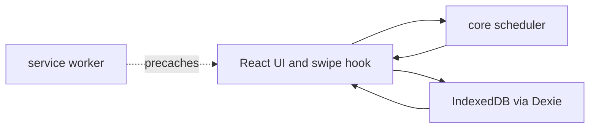

# Flagmania

Learn every country's flag and capital by swiping cards on your phone, with a spaced repetition scheduler deciding what comes next. Works offline.

[](https://github.com/Lydia-ivee/flagmania/actions/workflows/ci.yml)
[](LICENSE)

> Status. Early development. The live app shows the data and flags loading, and swiping arrives in the next milestone. The plan is in [docs/PRD.md](docs/PRD.md).

<!-- Only add a badge for a result the repository can back up. -->

<!-- Demo gif goes here, recorded on a phone, under 3 MB. -->

## Try it

[lydia-ivee.github.io/flagmania](https://lydia-ivee.github.io/flagmania/)

A QR code for phones will follow.

## How it works

Each card asks one thing, such as which country a flag belongs to. You swipe toward your answer.

Two things adapt as you go.

**What you are asked.** Every item sits in one of five Leitner boxes. Get it right and it moves up a box, so you see it less often. Get it wrong and it drops to box 1 and comes back a few cards later.

| Box | Next review        |
| --- | ------------------ |
| 1   | Later this session |
| 2   | 1 day              |
| 3   | 3 days             |
| 4   | 7 days             |
| 5   | 21 days            |

**How you are asked.** A miss makes the next question about that item easier. A correct answer makes it harder.

| Tier | Format          | Swipe             |
| ---- | --------------- | ----------------- |
| T0   | True or false   | Left or right     |
| T1   | Two options     | Left or right     |
| T2   | Four options    | Any direction     |
| T3   | Type the answer | Enter or swipe up |

An easy guess can only take an item so far. Box 3 and above need a correct answer from four options or a typed one.

### A worked example

1. Day 1. "This is the flag of Chad", true or false. You swipe right, correctly. Box 2, tier T1.
2. Day 2. Chad or Mali. You pick Mali. Back to box 1, tier T0, and it returns a few cards later.
3. Same session. True or false again. Correct. Box 2, tier T1.
4. Day 3. Chad or Mali. Correct. Still box 2, since a two-option guess cannot lift it higher. Tier T2.
5. Day 4. Chad, Romania, Andorra or Moldova. Correct. Box 3, and it comes back in 3 days.

The scheduler will be a set of pure functions in `src/core` with property-based tests.

## Run it locally

You need Node 22.18 or later.

```sh
npm install
npm run dev
```

Then open the address Vite prints. The other scripts are below.

| Command             | What it does                                                     |
| ------------------- | ---------------------------------------------------------------- |
| `npm test`          | Runs the unit tests                                              |
| `npm run lint`      | Checks the code with ESLint                                      |
| `npm run typecheck` | Checks types with TypeScript                                     |
| `npm run build`     | Builds the app into `dist`                                       |
| `npm run data`      | Rebuilds the country data and flags from Wikidata and flag-icons |

The country data is committed, so you only need `npm run data` to refresh it. It checks every country has a capital and a flag, and lists any capital where the two sources disagree.

## Install on Android

1. Open the live app in Chrome.
2. Tap the menu, then "Add to home screen".
3. Open it once with signal so it can save everything it needs.
4. From then on it works with no signal.

## Architecture



Decisions are recorded in [docs/adr](docs/adr).

## Data and credits

- Country names and capitals from [Wikidata](https://www.wikidata.org), CC0.
- Flags from [flag-icons](https://github.com/lipis/flag-icons), MIT.

The default deck is the 193 UN member states plus the 2 UN observer states. Disputed and dependent territories will live in an optional deck.

## Privacy

No accounts or analytics. Your progress stays on your device. You can export it as a file.

## Licence

MIT for the code. Data and images keep their own licences, listed above.
