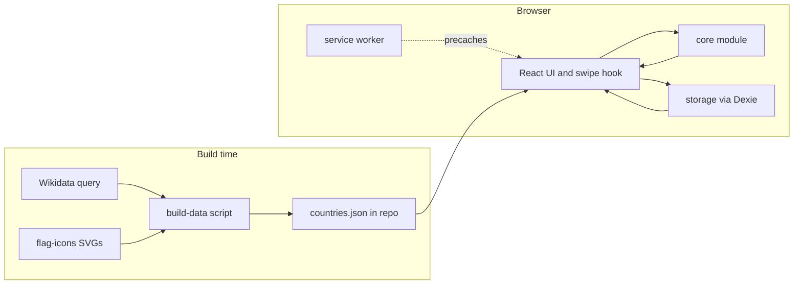

# Flagmania product requirements document

| Field        | Value            |
| ------------ | ---------------- |
| Name         | Flagmania        |
| Version      | 0.1              |
| Status       | Draft for review |
| Owner        | Lydia Miller     |
| Last updated | 23 November 2026 |

## 1. Summary

Flagmania is an offline-first study app for learning the flag and capital of every country. You learn by swiping cards. Behind the cards sits a spaced repetition scheduler that brings back what you miss within a few cards and hides what you know for days at a time. Question format adapts to how you are doing, from a simple true or false swipe up to typing the answer from memory. Landmarks, both human-made and natural, come later as an optional pack.

It runs in the browser on a laptop and installs on an Android phone as a progressive web app (PWA). Once installed it needs no signal, so it works on the London Underground. All progress stays on the device.

The project is public on GitHub and doubles as a portfolio piece. The engineering goal is a small codebase where the interesting logic is easy to find and test.

## 2. Problem statement

Geography quiz apps such as Seterra and Sporcle are good for testing what you already know, but they ask questions in a fixed or random order. Missed answers do not come back at the right time, so learning is slow. Many need a connection and carry ads.

Spaced repetition tools such as Anki solve the timing problem, but they take setup and are built for text flashcards rather than quick play on a phone.

There is room for a single-purpose app that combines the two. Fast, low-effort swiping for the commute, with proper scheduling underneath.

## 3. Goals and non-goals

### Goals

- Learn all 195 country flags and capitals through short daily sessions on a phone.
- Work fully offline after the first visit.
- Keep the adaptive logic in one pure, well-tested module that a reviewer can read in a few minutes.
- Present the repository so a visitor understands what it does and how it works within a minute of landing on it.

### Non-goals

- User accounts, cloud sync or any backend.
- Leaderboards, sharing or social features.
- Monetisation of any kind.
- Languages other than English in version 1.
- A native app store release.

## 4. Users

### Primary. The commuting learner

Uses an Android phone on the Tube for five to fifteen minutes at a time, often one-handed and with no signal. Wants to pick up where they left off without menus or loading. Cares about actually remembering the answers a month later.

### Secondary. The profile visitor

A hiring manager or engineer looking at the GitHub profile. Spends under two minutes on the repository. Wants to see it running and judge the code quality. Will tap a live demo link if one is obvious.

## 5. User stories

Priorities use MoSCoW (Must, Should, Could, Won't).

| ID    | As a    | I want to                                              | So that                                       | Priority   |
| ----- | ------- | ------------------------------------------------------ | --------------------------------------------- | ---------- |
| US-01 | learner | start a session with one tap from the home screen      | I can use dead time on a train                | Must       |
| US-02 | learner | swipe to answer                                        | I can play one-handed                         | Must       |
| US-03 | learner | see the correct answer straight after a miss           | I learn from the mistake at once              | Must       |
| US-04 | learner | have missed cards return later in the same session     | I get a second go while it is fresh           | Must       |
| US-05 | learner | have known cards stop appearing for a while            | sessions focus on what I do not know          | Must       |
| US-06 | learner | use the app with no signal                             | it works underground                          | Must       |
| US-07 | learner | pick which decks to study, flags or capitals           | I can focus on one skill                      | Must       |
| US-08 | learner | answer with buttons or arrow keys instead of swiping   | I can use it at a desk or with assistive tech | Must       |
| US-09 | learner | filter by region                                       | I can learn Europe before Oceania             | Should     |
| US-10 | learner | export and import my progress as a file                | I do not lose it when I change phone          | Should     |
| US-11 | learner | see my progress by region                              | I know where my gaps are                      | Should     |
| US-12 | learner | see a world map shaded by how well I know each country | I get a quick visual of progress              | Could      |
| US-13 | learner | turn on a landmarks pack                               | I can learn famous places too                 | Could      |
| US-14 | learner | include territories such as Greenland and Puerto Rico  | I can go beyond sovereign states              | Could      |
| US-15 | learner | sync progress across devices                           | I can switch between phone and laptop         | Won't (v1) |

## 6. Functional requirements

### 6.1 Decks and items

- A **country** is the unit of content. The default set is the 193 UN member states plus the 2 UN observer states (Holy See and Palestine), giving 195.
- Each country produces **items**, one per facet. Version 1 has four facets.

| Facet              | Prompt       | Answer       |
| ------------------ | ------------ | ------------ |
| flag-to-country    | A flag       | Country name |
| country-to-flag    | Country name | A flag       |
| country-to-capital | Country name | Capital      |
| capital-to-country | Capital      | Country name |

- Facets are scheduled independently. Knowing the flag of Chad says nothing about knowing its capital.
- The flags deck holds the first two facets and the capitals deck holds the last two. The learner turns each deck on or off.
- Capital-to-country is skipped where the capital names the country, such as Kuwait City or Vatican City, because the prompt would give the answer away. This drops 14 items, including Guinea-Bissau where the capital ends the name, so the two decks hold 766 items between them.

### 6.2 The swipe mechanic

Every question is a card. The answer options sit at the card's edges and the learner swipes toward their choice. This keeps one gesture across every question format.

| Tier | Format                                                              | Gesture                                                    | Notes                                                |
| ---- | ------------------------------------------------------------------- | ---------------------------------------------------------- | ---------------------------------------------------- |
| T0   | True or false claim, such as "Canberra is the capital of Australia" | Right for true and left for false. Down means "don't know" | Claims are true half the time                        |
| T1   | Two options                                                         | Left or right                                              | One distractor                                       |
| T2   | Four options                                                        | Up, down, left or right                                    | Three distractors                                    |
| T3   | Typed answer                                                        | Type, then press Enter                                     | Not available for country-to-flag, which stays at T2 |

- A sideways swipe commits once the card passes 35% of its own width, and a downward swipe at 25% of its height. Below that it springs back. Measuring against the card keeps the distance the same on a phone and a wide laptop screen.
- The card tilts and the chosen option highlights during the drag, so the learner sees what they are about to pick before letting go.
- After every answer a short feedback state shows right or wrong and, on a miss, the correct answer. A tap anywhere on the panel or the Enter key moves on. A right answer given by swiping moves on by itself after a moment. Answers given with a button or key always wait, so nobody is rushed.
- **Accessibility fallback.** Every swipe has a matching on-screen button and a keyboard shortcut (arrow keys, plus D for "don't know"). This meets WCAG 2.2 success criterion 2.5.1, which requires a single-pointer alternative to path-based gestures.

### 6.3 Adaptive difficulty

The original idea was "get it wrong and it gets easier, get it right and it gets harder". Applied to which question you see, this would swap a missed country for an easier one and the gap would never close. Flagmania splits the idea in two.

1. **What you are asked** is decided by a spaced repetition scheduler (Leitner boxes). A missed item comes back soon. A known item comes back rarely.
2. **How you are asked** follows the original idea. A miss lowers the format tier for that item. A correct answer raises it.

#### Leitner boxes

| Box | Next review                                |
| --- | ------------------------------------------ |
| 1   | Later in the same session, 3 to 5 cards on |
| 2   | 1 day                                      |
| 3   | 3 days                                     |
| 4   | 7 days                                     |
| 5   | 21 days                                    |

Rules, applied per item after each answer.

- **Correct.** Move up one box (capped at 5) and up one tier (capped at T3, or T2 for country-to-flag).
- **Wrong or "don't know".** Return to box 1 and drop one tier (floor T0). The item comes back 3 to 5 cards later in this session.
- **Guess guard.** A T0 answer has a 50% chance of being right by luck, so a correct answer at T0 or T1 can lift an item no higher than box 2. Box 3 and above need a correct answer at T2 or T3.
- **Typed answers unlock late.** T3 is offered only once an item reaches box 3, so the learner is not asked to type something they have barely seen.
- New items start in box 1 at T0.

#### Session builder

- A session is 20 cards by default (settings allow 10 to 50).
- Due items come first, most overdue at the top.
- New items fill the remaining space, up to 8 per session by default, so a backlog of reviews never gets buried under new material.
- Facets and regions are interleaved so the learner does not see four Balkan flags in a row unless they filtered for it.
- If nothing is due and the new-item cap is reached, the app says so and offers an optional practice round that does not affect the schedule.

#### Distractors

- At T1 a distractor comes from the same region.
- At T2 one distractor comes from a hand-curated lookalikes list where one exists (Chad and Romania, Indonesia and Monaco, Ireland and Côte d'Ivoire, Australia and New Zealand, Slovenia and Slovakia, Senegal and Mali). The rest come from the same region.
- The lookalikes list is a small JSON file in the repository, open to contributions.

#### Typed answer matching

- Normalise both strings by lowercasing, stripping diacritics, punctuation and a leading "the". "&" reads as "and" and "St" as "Saint".
- Accept any listed alternative name, such as "Ivory Coast" for Côte d'Ivoire or "Czechia" and "Czech Republic". Alternative names must be typed exactly. Only the main name allows typos.
- Allow an edit distance of 1 for answers up to 6 letters and 2 for longer ones. A near miss counts as correct and shows the proper spelling.
- Never accept another item's answer. A typo that sits as close to another country as to the right one does not count, and the feedback says the answer could mean more than one. An alias shared by two countries, such as "Congo", is dropped from both.
- Countries with more than one capital accept any of them. South Africa and Bolivia accept any of their capitals. The feedback state lists all of them.

### 6.4 Progress and settings

- A progress screen shows, per deck and per region, how many items sit in each box.
- Export writes all progress and settings to a single JSON file. Import reads one back after showing what will be replaced.
- The app requests persistent storage so the browser does not clear progress when space runs low.
- Settings cover session length, new items per session, decks, regions, reduced motion and the optional packs.

### 6.5 Landmarks pack (Could)

- Off by default and downloaded on demand when switched on, so it does not bloat the core install.
- Adds a landmark-to-country facet, with roughly two landmarks per country.
- Landmarks are tagged as human-made or natural so the learner can choose either or both. UNESCO World Heritage categories give this tagging at no extra effort.
- A credits screen lists the author and licence of every image.

## 7. Non-functional requirements

| Area            | Requirement                                                                                                                                                                                                   |
| --------------- | ------------------------------------------------------------------------------------------------------------------------------------------------------------------------------------------------------------- |
| Offline         | After the first load, every core feature works with the network switched off. Tested in CI with Playwright in offline mode.                                                                                   |
| Install         | Meets Chrome's installability criteria on Android, with an app icon and standalone display.                                                                                                                   |
| Performance     | JavaScript under 150 KB gzipped. Core precache under 5 MB. Card drag holds 60 frames per second on a mid-range Android phone (Pixel 6a class). Offline cold start under 1.5 seconds on the same phone.        |
| Accessibility   | WCAG 2.2 AA. Every gesture has a button and keyboard alternative. Respects prefers-reduced-motion. Visible focus states. Contrast checked in both light and dark themes.                                      |
| Privacy         | No analytics, cookies, trackers or third-party requests after install. No personal data leaves the device, so UK GDPR obligations for the developer do not arise. A short privacy note in the README says so. |
| Browser support | Latest two versions of Chrome on Android. Latest Chrome, Edge, Firefox and Safari on desktop. iOS Safari should work but is not a target.                                                                     |
| Reliability     | Progress writes are transactional. A crash mid-answer never corrupts saved state.                                                                                                                             |
| Maintainability | Strict TypeScript. The core module has no imports from the UI or storage layers.                                                                                                                              |

## 8. Technical approach

### 8.1 Stack

| Layer            | Choice                             | Reason                                                                                  |
| ---------------- | ---------------------------------- | --------------------------------------------------------------------------------------- |
| Language         | TypeScript (strict)                | Types make the scheduler rules explicit and readable                                    |
| UI               | React with Vite                    | Widely recognised by reviewers, fast dev server, small production build                 |
| Gestures         | A small custom Pointer Events hook | Roughly 100 lines, no dependency, and a readable piece of the codebase in its own right |
| Storage          | IndexedDB through Dexie            | Survives restarts and handles transactions                                              |
| Offline          | vite-plugin-pwa (Workbox)          | Generates the service worker and precache manifest from the build                       |
| Unit tests       | Vitest with fast-check             | Property-based tests suit a scheduler with invariants                                   |
| End-to-end tests | Playwright                         | Covers swipe, keyboard and offline flows                                                |
| CI and hosting   | GitHub Actions and GitHub Pages    | Free, and gives a live demo link                                                        |

Svelte is a reasonable swap for React if a lighter framework is preferred. The decision is recorded in an ADR either way.

### 8.2 Why a PWA

- One codebase covers laptop and Android.
- No app store account or APK signing.
- A live link in the README lets a visitor try it in seconds, which a React Native or Flutter build cannot match without an install.
- The trade-off is weaker iOS support and no access to native APIs, neither of which this app needs.

### 8.3 Architecture



The **core** module is pure functions only. It takes the saved state and the current time and returns the next card or the updated state. It never reads the clock or the database itself. This keeps it deterministic and easy to test.

### 8.4 Repository layout

```text
flagmania/
  src/
    core/          scheduler, session builder, distractors, answer matching
    ui/            React components and the swipe hook
    storage/       Dexie schema, export and import
    data/          generated countries.json and lookalikes.json
  scripts/
    build-data.ts  fetches and normalises country data
  public/flags/    SVG flags copied from flag-icons
  docs/
    PRD.md
    adr/           architecture decision records
    images/        README gif and screenshots
  tests/e2e/       Playwright specs
```

### 8.5 Data model

| Store    | Key                | Fields                                                             |
| -------- | ------------------ | ------------------------------------------------------------------ |
| items    | `${iso2}-${facet}` | box, tier, dueAt, lastSeenAt, correctCount, wrongCount             |
| answers  | auto               | itemId, answeredAt, tier, correct, responseMs                      |
| settings | single row         | sessionLength, newPerSession, decks, regions, packs, reducedMotion |

The answers log feeds the progress screen and any future charts. It is capped at the most recent 10,000 rows.

### 8.6 Testing

- **Scheduler invariants** checked with property-based tests across thousands of random answer sequences.
  - A box never leaves the range 1 to 5.
  - A wrong answer always returns the item to box 1.
  - An item never reaches box 3 without a correct answer at T2 or T3.
  - The next due date is never earlier than the answer time.
- **Answer matching** covered by a table of real inputs, including alternative names, diacritics and typos.
- **End to end** covers a session by swipe, a session by keyboard, a session with the network disabled after install, and an export followed by a re-import.
- CI runs lint, type check, unit tests, end-to-end tests, a build and a Lighthouse check on every pull request.

## 9. Data sources and licensing

| Content                                             | Source                                 | Licence                             | Notes                                                                                                                |
| --------------------------------------------------- | -------------------------------------- | ----------------------------------- | -------------------------------------------------------------------------------------------------------------------- |
| Country names, capitals, regions, alternative names | Wikidata                               | CC0                                 | No attribution required, credited anyway. Pulled by a build script and committed so builds are reproducible offline. |
| Flags                                               | flag-icons                             | MIT                                 | SVG, 4x3 ratio. Flags themselves are generally free of copyright.                                                    |
| Landmark list and category                          | Wikidata (UNESCO World Heritage items) | CC0                                 | The UNESCO category gives the human-made or natural tag                                                              |
| Landmark photos                                     | Wikimedia Commons                      | Per image, mostly CC BY-SA or CC BY | Attribution required for each image. Needs research, see below.                                                      |
| World map (Could)                                   | Natural Earth                          | Public domain                       | Only if the map view is built                                                                                        |

### Areas needing research

- **Landmark photo licences.** Each Commons image carries its own licence and author. The build script needs to read this from the Commons API and write a credits file. Resized images remain under CC BY-SA, which is fine for a public repository as long as attribution is shown in the app and in a CREDITS file.
- **Freedom of panorama.** Some countries restrict photos of modern buildings (France and Italy, for example). Commons handles most of this, but recent landmarks need a check before inclusion.
- **Flag freshness.** flag-icons can lag behind a flag change. The build script should compare its list against Wikidata's flag property and report any mismatch.
- **REST Countries and mledoze/countries.** Both are popular, but mledoze/countries is under ODbL, which adds share-alike terms to any derived database. Wikidata avoids this and is the recommended primary source.

### Content policy

- The default deck is the 193 UN members plus the 2 observer states. This is a neutral, documented line.
- Kosovo, Taiwan and other disputed or partially recognised places sit in an optional territories deck along with dependencies such as Greenland.
- The README states this rule in one paragraph so the choice reads as deliberate.
- Capital and name changes (Astana and Kyiv, for example) are picked up by re-running the data script. The data file records the date it was generated.

## 10. Success measures

### Learning

- The owner can name every flag in the default deck at T3 or T2 within 10 weeks of daily 10-minute sessions.
- Retention at the 21-day review stays above 85%.

### Engineering

- 100% line and branch coverage on the core module.
- Lighthouse scores of 95 or above in every category.
- All performance budgets in section 7 met on a real Android phone.
- Offline session completed end to end on the Underground.

### Presentation

- A first-time visitor can find the live demo and the gif without scrolling past the first screen of the README.
- At least four ADRs explain the main decisions.

## 11. Release plan

| Milestone              | Contents                                                                              | Exit check                                                |
| ---------------------- | ------------------------------------------------------------------------------------- | --------------------------------------------------------- |
| M0 Foundations         | Repository, CI, Pages deploy, data script, ADR 0001                                   | Empty app live on Pages with green CI                     |
| M1 Walking skeleton    | Flag-to-country facet, T0 swipe, Leitner boxes, local storage                         | A full session on the phone, progress kept after a reload |
| M2 Adaptive formats    | T1 to T3, country-to-flag facet, lookalike distractors, typed matching, capitals deck | All scheduler property tests pass                         |
| M3 Offline and install | Service worker, install prompt, export and import, region filter                      | Offline Playwright test passes, session done on the Tube  |
| M4 Presentation        | README, demo gif, screenshots, remaining ADRs, Lighthouse in CI                       | README checklist in appendix A complete                   |
| M5 Landmarks pack      | Commons pipeline, credits screen, landmark facet, human-made and natural filter       | Every image has an author and licence in CREDITS          |

M0 to M4 is version 1.0. M5 is optional and starts only once 1.0 is in daily use.

## 12. Risks

| Risk                                                             | Likelihood | Impact | Mitigation                                                                                    |
| ---------------------------------------------------------------- | ---------- | ------ | --------------------------------------------------------------------------------------------- |
| Solo scope creep, landmarks pulling effort before the core works | High       | High   | Landmarks are Could and sit behind M4. No new facets until 1.0.                               |
| Swipe feels laggy on a cheaper phone                             | Medium     | High   | Test on a real device from M1. Animate transform and opacity only.                            |
| Four-direction swipe confuses new learners                       | Medium     | Medium | Options always drawn at the edge they map to. Buttons always visible.                         |
| Landmark images break licence terms                              | Medium     | Medium | Automated credits from the Commons API. Manual check of any image without clear licence data. |
| Disputed territory choices draw criticism                        | Low        | Medium | Documented UN-based rule. Territories in an optional deck.                                    |
| Lost progress on phone change or cleared site data               | Medium     | Medium | Export and import in M3. Request persistent storage from the browser.                         |
| The idea reads as "another flag quiz" on GitHub                  | Medium     | Medium | README leads with the scheduler and offline play, with a worked example.                      |

## 13. Assumptions

- English only for version 1.
- No accounts and no backend.
- Learning comes first. Where a feature helps learning but not the README, learning wins.
- The owner has an Android phone with a recent Chrome for testing.
- The project is built in spare time, so milestones are ordered by value, not dated.

## 14. Open questions

| ID   | Question                                                                                                                                                                                                        | Leaning                                                                                                                                                                                          |
| ---- | --------------------------------------------------------------------------------------------------------------------------------------------------------------------------------------------------------------- | ------------------------------------------------------------------------------------------------------------------------------------------------------------------------------------------------ |
| OQ-1 | React or Svelte                                                                                                                                                                                                 | React, for recognition on a profile                                                                                                                                                              |
| OQ-2 | How flag questions work for screen reader users, since alt text would give the answer away                                                                                                                      | Offer a text description of the flag as an opt-in mode, or exclude flag-to-country for screen readers and say so                                                                                 |
| OQ-3 | Whether the territories deck is in 1.0                                                                                                                                                                          | Leave it for after 1.0                                                                                                                                                                           |
| OQ-4 | Whether landmark photos are worth the licence work, or names with a map pin are enough                                                                                                                          | Decide at M5 after a trial with ten countries                                                                                                                                                    |
| OQ-5 | Whether cross-device sync is ever wanted                                                                                                                                                                        | Not in scope. Export and import covers the need for now.                                                                                                                                         |
| OQ-6 | Which capital to teach where it is contested or moving. Wikidata currently gives Israel as Jerusalem, Palestine as East Jerusalem or Ramallah, Equatorial Guinea as Ciudad de la Paz and Yemen as Aden or Sanaa | Accept every listed capital in typed answers. Decided 23 November 2026. Every listed capital counts as right. `scripts/overrides.json` adds Malabo for Equatorial Guinea, with a written reason. |

## 15. Glossary

| Term       | Meaning                                                                    |
| ---------- | -------------------------------------------------------------------------- |
| Item       | One country and one facet, such as "France, flag-to-country"               |
| Facet      | A direction of question, such as country to capital                        |
| Box        | The Leitner box an item sits in, from 1 (new or missed) to 5 (well known)  |
| Tier       | The format an item is asked in, from T0 (true or false) to T3 (typed)      |
| Distractor | A wrong option shown alongside the right one                               |
| ADR        | Architecture decision record, a short note explaining one technical choice |
| PWA        | Progressive web app, a website that installs and runs offline like an app  |

## Appendix A. README checklist

The README follows common open-source conventions, in this order.

1. Name and a one-sentence description in plain words.
2. Badges for CI, test coverage, Lighthouse score and licence. Only badges that reflect real results.
3. A looping gif of a session, under 3 MB, recorded on a phone.
4. A "Try it" link to the live app and a QR code for opening it on Android.
5. A short "How it works" section with the Leitner table and a worked example of one item moving through the boxes.
6. "Run it locally" with the exact commands.
7. "Install on Android" in a few steps with one screenshot.
8. An architecture diagram in Mermaid and a pointer to the core module.
9. Links to the ADRs.
10. Data sources and credits.
11. A roadmap pointing at open issues.
12. Licence (MIT for the code).

### Writing rules for the README

- Describe what it does and how. Skip adjectives about how good it is.
- Short sentences. One idea per paragraph.
- Show, then explain. The gif and the demo link come before any prose.
- Every claim in a badge or a sentence can be checked in the repository.

## Appendix B. Planned ADRs

| Number | Decision                                                |
| ------ | ------------------------------------------------------- |
| 0001   | A PWA instead of React Native or Flutter                |
| 0002   | Leitner boxes instead of SM-2                           |
| 0003   | Wikidata instead of REST Countries or mledoze/countries |
| 0004   | No backend, local-only storage                          |
| 0005   | A custom swipe hook instead of a gesture library        |
